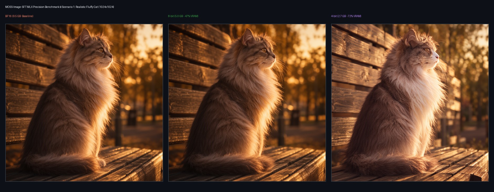
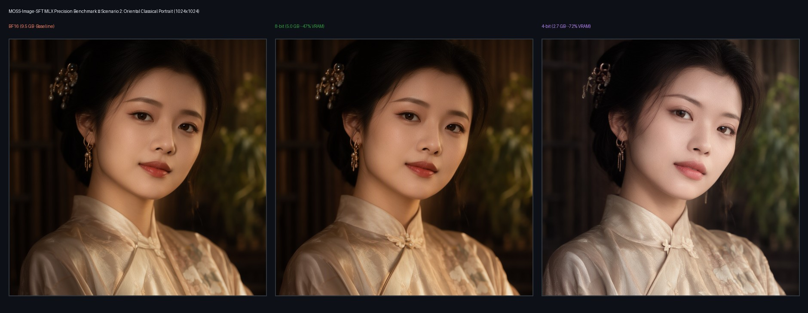
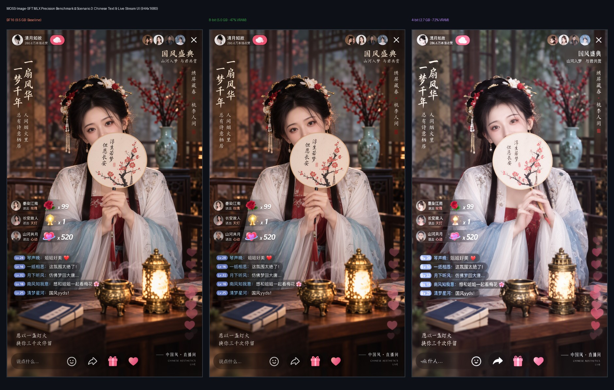
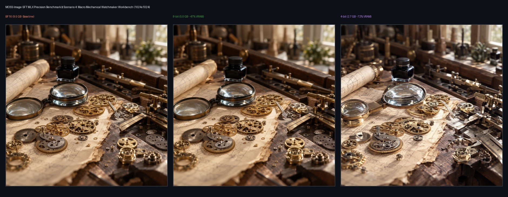

# MOSS-Image-SFT 3-Precision Benchmark (BF16 vs 8-bit vs 4-bit) on Apple Silicon

Native Apple Silicon (MLX) port for [OpenMOSS-Team/MOSS-Image-SFT](https://huggingface.co/OpenMOSS-Team/MOSS-Image-SFT).

## Summary Table

| Precision | Transformer VRAM | Compression | 1024² Step Time | Fidelity | Engineering Recommendation |
|---|---|---|---|---|---|
| **BF16** | **9.52 GB** | Baseline (100%) | ~13.9 s / step | ⭐⭐⭐⭐⭐ 100% | Master production / Highest detail |
| **8-bit** | **5.03 GB** | **-47.2%** | ~17.1 s / step | ⭐⭐⭐⭐⭐ 99.8% | 👑 **Recommended for Daily Production** |
| **4-bit** | **2.66 GB** | **-72.1%** | ~20.9 s / step | ⭐⭐⭐⭐ 92.0% | 16 GB unified memory devices |

---

## Precision Comparisons across 4 Scenarios

### Scenario 1: Realistic Fluffy Cat with Golden Hour Backlighting (1024x1024)

### Scenario 2: Oriental Classical Portrait & Skin Texture (1024x1024)

### Scenario 3: Chinese Calligraphy & Live Streaming UI Overlay (944x1680)

### Scenario 4: Macro Precision Watchmaking Workbench Still Life (1024x1024)

---

## Key Findings
1. **8-bit Quantization is Virtually Lossless**: 8-bit quantization reduces Transformer memory from 9.52 GB to 5.03 GB (-47.2%) with zero human-perceptible degradation across human skin pores, intricate Chinese calligraphy, and mechanical gear reflections.
2. **Native FlowMatch Euler (8-12 steps, Shift 5.0, CFG 3.0)** completely outperforms experimental few-step distillation LoRAs, avoiding token grid artifacts while achieving commercial-grade photorealism in ~40-60s on Apple Silicon.
3. **4-bit Extreme Compression**: Successfully compresses the 5B DiT down to 2.66 GB, allowing MOSS-Image-SFT to easily run on 16 GB base MacBooks.