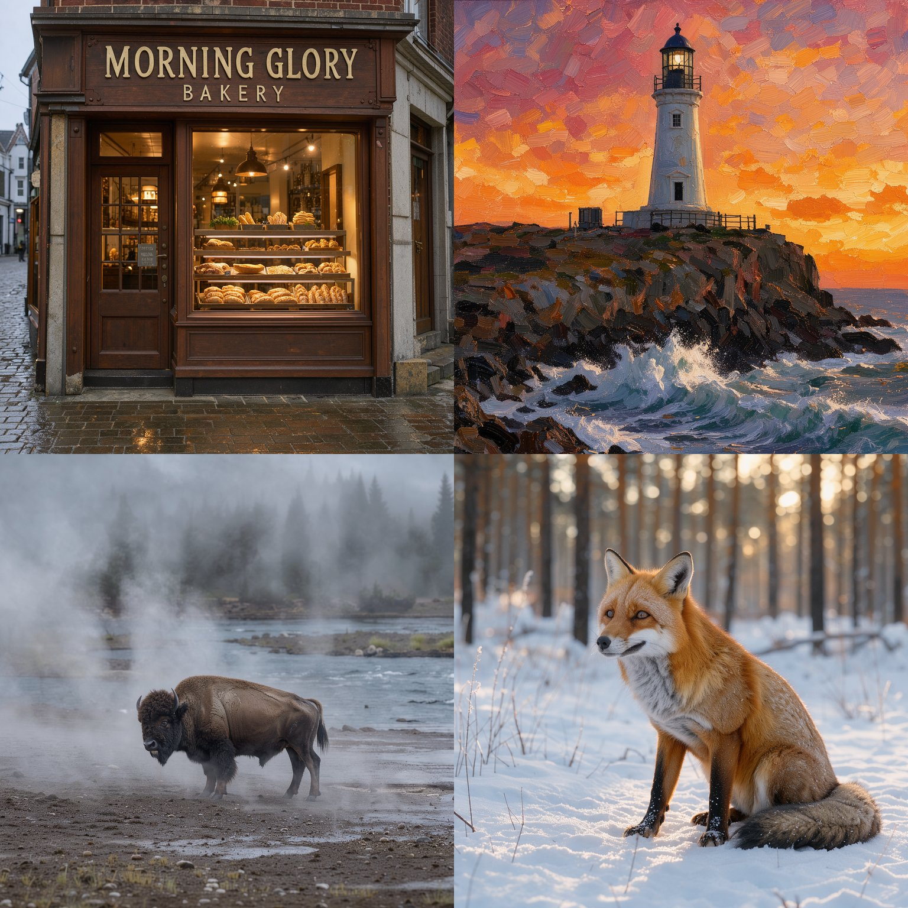
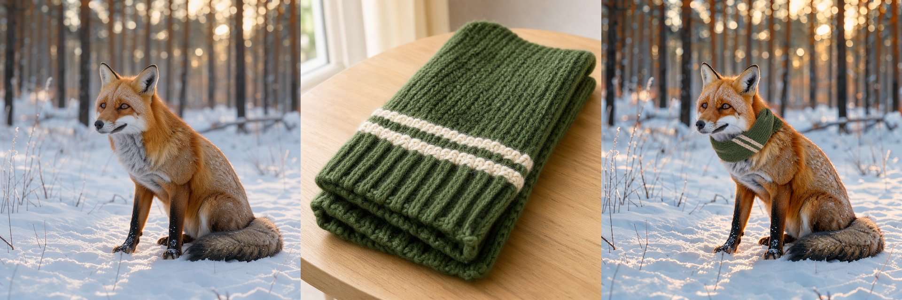

# FLUX 3 Image Klein
This directory contains MFLUX's MLX implementation of **FLUX 3 Image Klein**.

MFLUX supports [FLUX 3 Image Klein](https://huggingface.co/black-forest-labs/flux-3-image-klein) (distilled, 16 steps) and [FLUX 3 Image Klein Base](https://huggingface.co/black-forest-labs/flux-3-image-klein-base) (undistilled, 50 steps with guidance) from Black Forest Labs. It is a 5.6B-parameter transformer with a Qwen3-VL-4B text encoder. One model does text-to-image generation, single-reference editing and multi-reference composition (up to 10 reference images). It also reads bounding boxes in the prompt and renders text inside images.

All the standard modes of mflux apply: quantization (`-q 4`, `-q 6`, `-q 8`), `mflux-save`, `--low-ram`, VAE tiling, metadata export and `--config-from-metadata`, and `--compute-precision float16`.



*Distilled model, 1024×1024, 16 steps: the bakery prompt below, an oil-painting lighthouse, a bison in a geothermal landscape and a fox in snow.*

> [!WARNING]
> The weights are released under the [FLUX Kommunity License v.1.0](https://huggingface.co/black-forest-labs/flux-3-image-klein-base/blob/main/LICENSE.md): non-commercial use, plus commercial output generation by Qualifying Users (less than US$5M gross annualized revenue, including affiliates), subject to the license terms. Read the license and accept it on the Hugging Face model page (and log in with `hf auth login`) before the first download. The Qwen3-VL text encoder is under Apache-2.0.

## Example
The following uses the distilled model (16 steps, no guidance) for a text-to-image generation:

```sh
mflux-generate-flux3 \
  --prompt "A cozy corner bakery storefront in the early morning, a wooden sign above the door reading 'MORNING GLORY BAKERY' in cream-colored letters, a window full of fresh bread and pastries, warm light inside, wet cobblestone street, photograph" \
  --seed 3 \
  --width 1024 \
  --height 1024
```

`--steps` defaults to 16. Width and height must be multiples of 16.

<details>
<summary>Python API</summary>

```python
from mflux.models.common.config import ModelConfig
from mflux.models.flux3.variants import Flux3Klein

model = Flux3Klein(model_config=ModelConfig.flux3_image_klein())
image = model.generate_image(
    seed=3,
    prompt="A cozy corner bakery storefront in the early morning, a wooden sign above the door reading 'MORNING GLORY BAKERY' in cream-colored letters, a window full of fresh bread and pastries, warm light inside, wet cobblestone street, photograph",
    width=1024,
    height=1024,
)
image.save("bakery.png")
```
</details>

## Base model example
The Base checkpoint is undistilled. It runs 50 steps with classifier-free guidance (`--guidance` defaults to 3.5), so every step is two transformer passes. It is meant for fine-tuning and research; for generating and editing images use the distilled model.

```sh
mflux-generate-flux3 \
  --model flux3-image-klein-base \
  --prompt "A wide-angle photograph of a lone American bison in a misty geothermal landscape, half hidden by white steam, a slate-blue stream and evergreens fading into the mist behind. Muted, cool palette, soft overcast light." \
  --seed 0
```

For the distilled model `--guidance` has no effect and mflux prints a warning.

## Image-conditioned editing
`mflux-generate-flux3-edit` takes one to ten reference images. The width and height default to the size of the first reference (a single reference is cropped back to its own aspect ratio); pass `--width` and `--height` to choose another size.



Edit with a single reference, here as a full caption of the result (the golden test of this repository runs this edit):

```sh
mflux-generate-flux3-edit \
  --image-paths dog.jpg \
  --prompt "A golden retriever puppy sitting upright on a gray stone patio at night under a full moon, holding a yellow tulip in its mouth, cool blue moonlight, deep shadows, stars in the sky above dark cypress trees and a wooden lattice fence, photograph" \
  --seed 42
```

Combine several references (the picture above: a fox, a scarf and the result):

```sh
mflux-generate-flux3-edit \
  --image-paths fox.png scarf.png \
  --prompt "A red fox sitting in fresh snow at the edge of a pine forest, wearing the dark green wool scarf with a cream stripe wrapped around its neck, soft morning light, shallow depth of field." \
  --seed 1
```

<details>
<summary>Python API</summary>

```python
from mflux.models.common.config import ModelConfig
from mflux.models.flux3.variants import Flux3KleinEdit

model = Flux3KleinEdit(model_config=ModelConfig.flux3_image_klein())
image = model.generate_image(
    seed=1,
    prompt="A red fox sitting in fresh snow at the edge of a pine forest, wearing the dark green wool scarf with a cream stripe wrapped around its neck, soft morning light, shallow depth of field.",
    image_paths=["fox.png", "scarf.png"],
)
image.save("fox_scarf.png")
```
</details>

## Writing prompts
The caption controls the composition; reference images anchor content but do not lock structure. The model card recommends:

- **Write full scene captions** (framing, subject, background, lighting). A short prompt gives generic output, and a one-line instruction such as "make it blue" reframes the whole shot.
- **For edits, describe the target image** as a complete caption of the reference with the edit folded in, like the examples above. For style, describe attributes (palette, stroke, texture) rather than naming an artwork.
- **mflux does not rewrite prompts.** The reference code runs a separate prompt upsampler (`black-forest-labs/flux-3-image-klein-pup`) that turns a short request into a full caption. You can use it yourself, or write the caption by hand.

### Bounding boxes
For layout control, append a JSON list of elements to the caption. Each box is `[top, left, bottom, right]` on a 0 to 1000 grid, and the caption tags the element with `<id>`. There is no flag for this; the list is part of the prompt:

```sh
mflux-generate-flux3 \
  --prompt 'Minimalist graphic illustration featuring a black silhouette of a person <silhouette_1> centered against a solid, vibrant chartreuse background <background_1>. The figure is captured in a dynamic, mid-stride running pose, facing toward the left side of the frame. [{"id": "background_1", "bbox": [0, 0, 1000, 1000], "desc": "A flat field of neon yellow-green with a subtle paper texture and fine, organic grain."}, {"id": "silhouette_1", "bbox": [150, 150, 850, 850], "desc": "A black silhouette of a person in motion, made of dense stippled ink."}]' \
  --seed 1
```

For edits by box, refer to the n-th reference as `<ref_image_n>` and give each element `from`, `src_bbox` and `tgt_bbox` (a `null` target removes the element). Boxes set placement and scale, not a hard mask. See the [BFL documentation](https://docs.bfl.ai/flux_3/flux3_image_bounding_boxes) for the full format.

## LoRA
Both commands take `--lora PATH [SCALE]` (repeatable) and `--no-bake-lora`, as described in the [common README](../common/README.md#lora-basics). mflux reads FLUX 3 LoRAs in the BFL key names that ComfyUI and ai-toolkit write (`diffusion_model.content_mode_blocks.image.0.q_proj.lora_A.weight`, `single_blocks.N.mlp_in`, ...), in diffusers/PEFT names (`transformer.mode_blocks.image.0.attn.to_q.lora_A.weight`), and in kohya `lora_unet_` names, on every linear layer of the transformer. For example, [ausboss/FLUX-3-Image-Klein-Outpaint-LoRA](https://huggingface.co/ausboss/FLUX-3-Image-Klein-Outpaint-LoRA) extends a picture padded with flat gray `#808080`:

```sh
mflux-generate-flux3-edit \
  --image-paths padded.png \
  --lora ausboss/FLUX-3-Image-Klein-Outpaint-LoRA 1.5 \
  --prompt "Outpaint the image: replace the solid gray areas with a seamless continuation of the scene, keeping the existing picture unchanged. Scene: A tiger swimming in a calm jungle river, lush green ferns and trees on both banks, warm sunlight through the canopy" \
  --seed 42 -q 8
```

On a picture padded on the left and the top (distilled model, `-q 8`, seed 42), the original part moved by 86 px without the LoRA (the model zoomed in by 7%) and by 0 px with it. A LoRA trained on the distilled model that also adapts `ref_time_in` (the target time embedding) cannot load on the Base model, which has no such layer, and stops with an error.

## Quantization
`-q 4`, `-q 6` and `-q 8` quantize the model when it loads. Measured on an M4 Pro (64 GB), distilled model, 1024×1024, 16 steps, seed fixed. The PSNR compares each image with the unquantized one (the quantized images look clean; the difference is in fine detail):

| | On disk (`mflux-save`) | Peak memory | Time per step | PSNR vs bf16 |
|---|---|---|---|---|
| bf16 | – | 30.7 GB | 6.4 s | – |
| `-q 8` | 9.2 GB | 22.8 GB | 7.0 s | 44.5 dB |
| `-q 6` | 7.1 GB | 20.6 GB | 7.1 s | 28.2 dB |
| `-q 4` | 5.0 GB | 18.5 GB | 7.0 s | 25.2 dB |

Quantization saves memory, not time. Save a quantized model once and load it from disk:

```sh
mflux-save --model flux3-image-klein --quantize 4 --path ~/models/flux3-klein-q4
mflux-generate-flux3 --model ~/models/flux3-klein-q4 --prompt "..."
```

> [!IMPORTANT]
> A saved model is identified by its directory name. A saved **Base** model loads as the distilled model unless its directory name contains `flux3-klein-base` (or another alias of the Base entry), or you pass `--base-model flux3-klein-base`. For example, save Base to `~/models/flux3-klein-base-q8`.

## Speed and size
- Distilled, 1024×1024, bf16: about 105 s per image including model load on an M4 Pro (6.4 s per step).
- Base, 1024×1024: about 630 s for text-to-image and about 1400 s for an edit with one reference.
- `--compute-precision float16` runs attention and feed-forward in float16 (no inf/NaN at 1024²; PSNR against bf16 of 39 to 49 dB). It is meant for Apple M1-family GPUs, see the [common README](../common/README.md#float16-compute-apple-m1-family).

> [!WARNING]
> mflux downloads about 20 GB per checkpoint: the transformer (11.1 GB), the text encoder (8.9 GB) and the VAE (0.3 GB). The Hugging Face repositories also hold the BFL-format `model.safetensors` and `ae.safetensors` (about 11 GB more) that mflux does not fetch. The distilled and the Base checkpoint are separate downloads. Use quantization for smaller sizes on disk and in memory.

## Notes
- `--negative-prompt` is not supported and exits with an error.
- `--guidance` only matters for the Base checkpoint. The distilled checkpoint ignores it with a warning.
- Both commands accept `--model flux3-image-klein` (default, aliases `flux3-klein`, `flux3`) and `--model flux3-image-klein-base` (aliases `flux3-klein-base`, `flux3-base`).
- The VAE is the FLUX.2 VAE (identical weights).
- Not ported from the reference implementation: the prompt upsampler (a separate 18.8 GB model), the NSFW safety classifier, the FP8 and NVFP4 transformer variants, and LoRA training. `mflux-train` is not available for this model.
- Slow golden tests run at 512×512 or smaller: `tests/image_generation/test_generate_image_flux3_klein.py` and `..._flux3_klein_edit.py`.
